<div align="center">

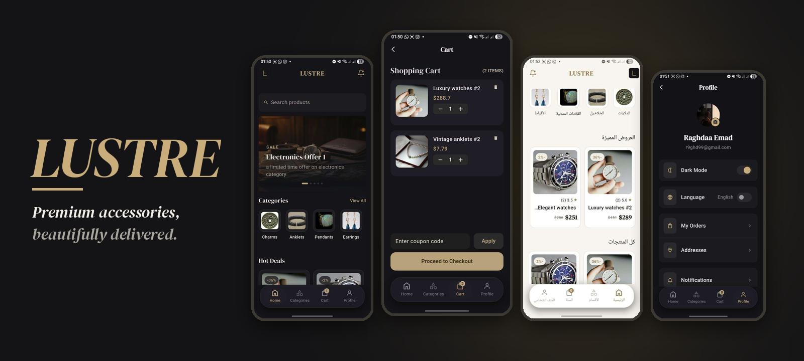

# LUSTRE

### A premium accessories e-commerce mobile app built with Flutter

Watches · Rings · Earrings · Anklets · Pendants · Wallets — delivered fast, priced fairly.

[Features](#features) · [Screenshots](#screenshots) · [Getting Started](#getting-started) · [Team](#team)


</div>

---

## Table of Contents

- [About the Project](#about-the-project)
- [Features](#features)
- [Screenshots](#screenshots)
- [Demo](#demo)
- [Tech Stack](#tech-stack)
- [Architecture](#architecture)
- [Project Structure](#project-structure)
- [Design System](#design-system)
- [Getting Started](#getting-started)
- [Backend API](#backend-api)
- [Roadmap](#roadmap)
- [Team](#team)
- [Acknowledgements](#acknowledgements)
- [License](#license)

---

## About the Project

**Lustre** is a full-featured e-commerce mobile application for an accessories store. It covers the whole shopping journey — from signing up and browsing categories, to viewing product details and reviews, managing a cart with coupons, saving delivery addresses, and tracking orders — plus an **admin dashboard** for managing the product catalog.

The app ships with a refined **dark and light theme** (gold-accented), full **English / Arabic** localization with RTL support, and a clean feature-first architecture built on **Bloc/Cubit**.

---

## Features

### Customer
- **Onboarding & splash** screens for a polished first impression
- **Authentication** — register with email OTP verification, login, **Google Sign-In**, forgot / reset password with OTP, and change password
- **Home** — promo banners, category chips, *Hot Deals*, and all products
- **Categories & search** — browse by category and search products
- **Product details** — image gallery, specs (color, weight, stock), quantity selector, ratings, and **customer reviews** (write your own review)
- **Cart** — add / remove items, change quantity, apply **coupon codes**, and a friendly empty state
- **Checkout & orders** — payment method selection, order summary, order history, order details, and an **order tracking timeline**
- **Addresses** — add, edit, and delete delivery addresses
- **Profile** — profile photo upload, notifications (read / unread), privacy policy, about us, contact us, and secure logout
- **Dark / Light mode** and **English / Arabic (RTL)** — switchable at any time from the profile

### Admin
- **Admin dashboard** (shown only to the designated admin account) to list, search, add, and delete products — with bilingual (EN/AR) name and description, price, stock, color, category, and cover image upload

---

## Screenshots

### Authentication

<div align="center">
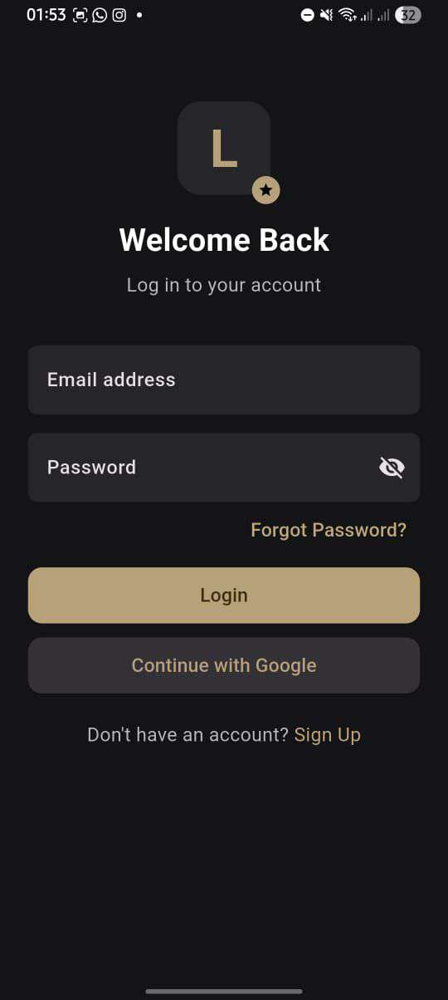
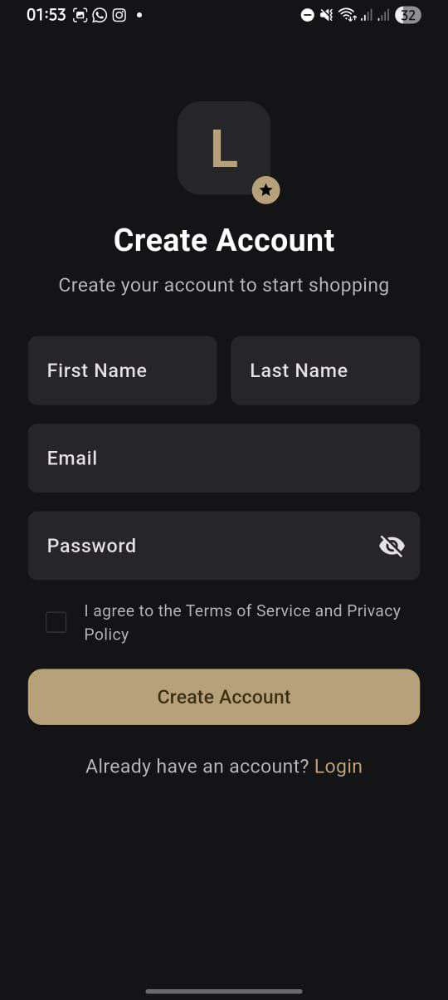
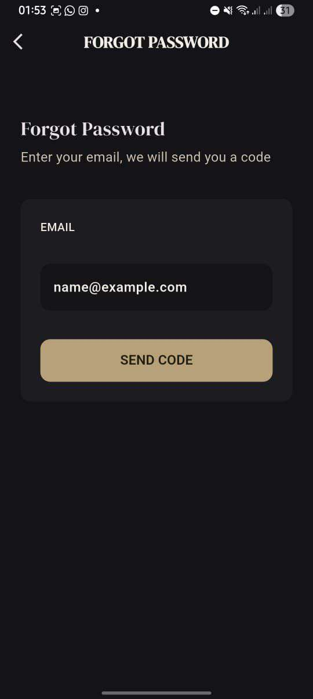
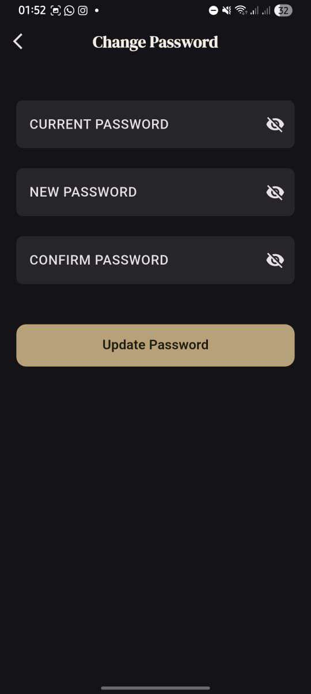
</div>

### Shopping

<div align="center">
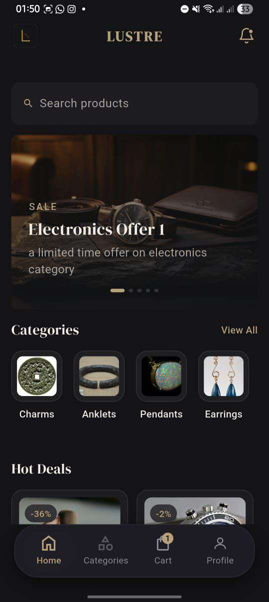
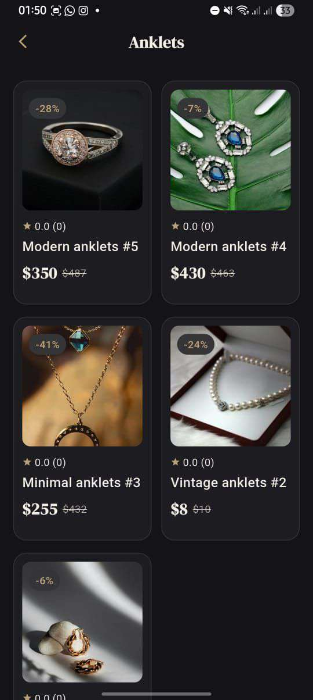
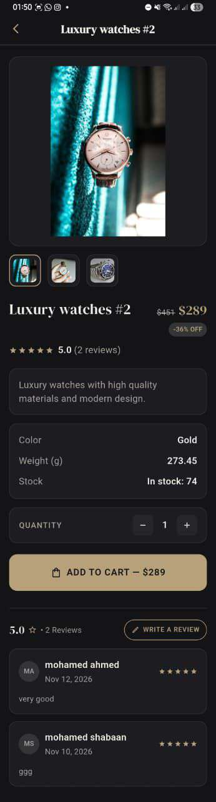
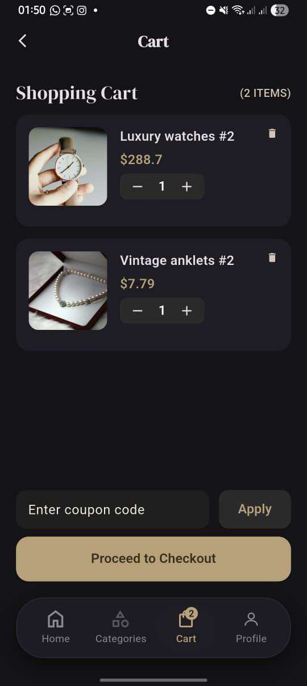
</div>

### Orders, Addresses & Profile

<div align="center">
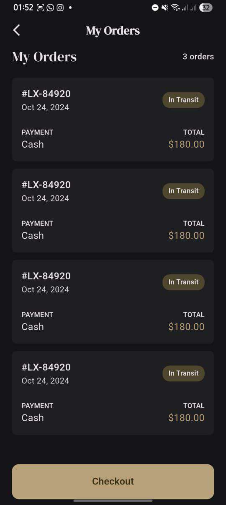
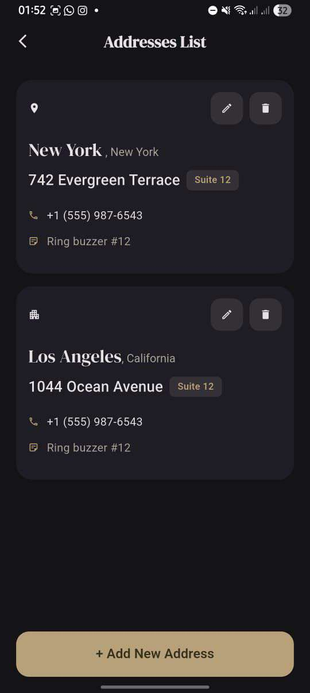
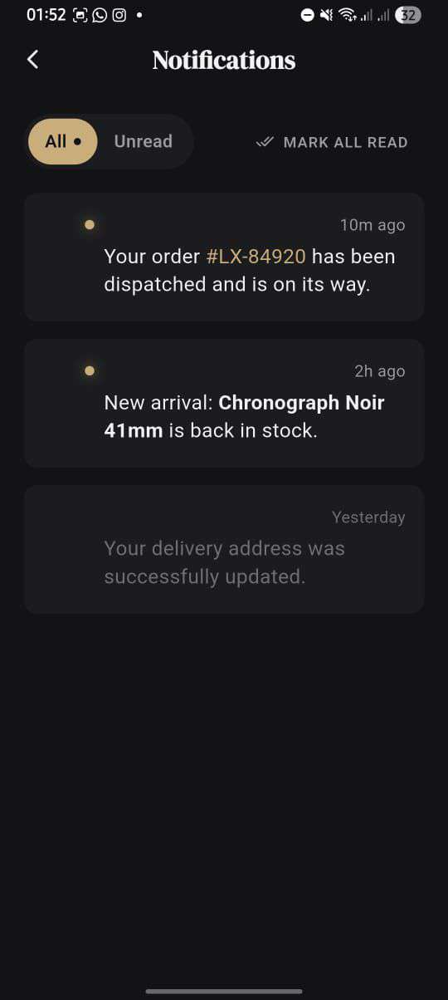
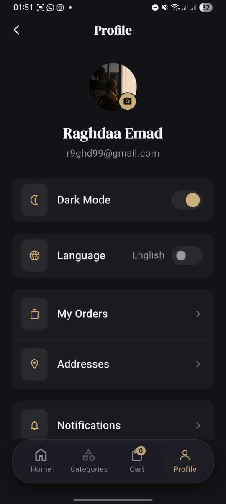
</div>

### Light Mode & Arabic (RTL)

<div align="center">
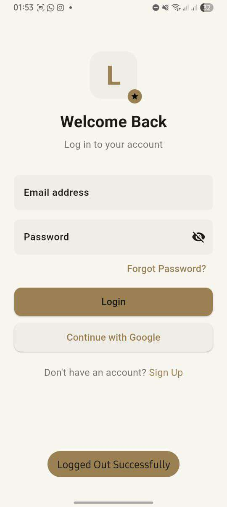
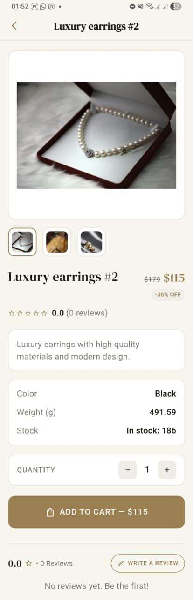
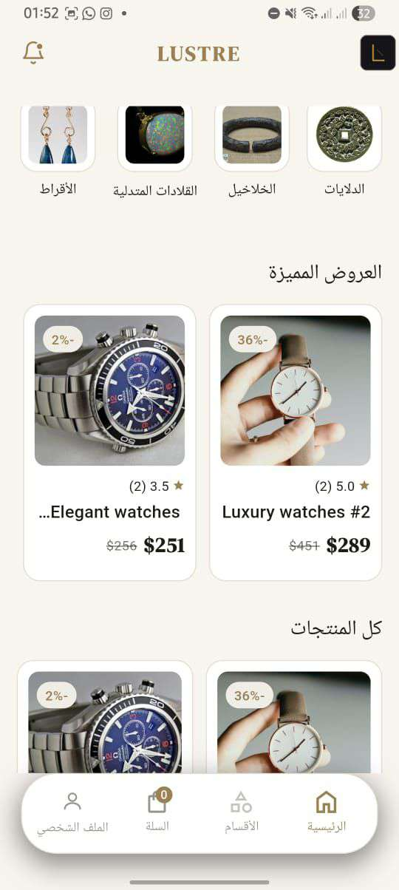
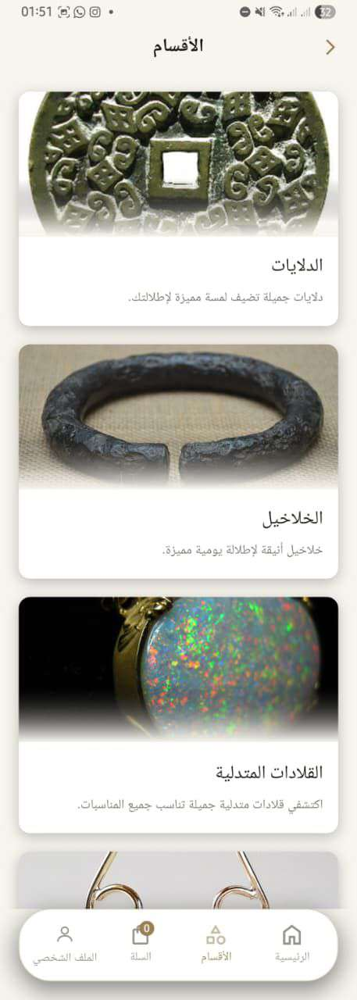
</div>

<details>
<summary><b>More screens</b></summary>
<br/>

<div align="center">
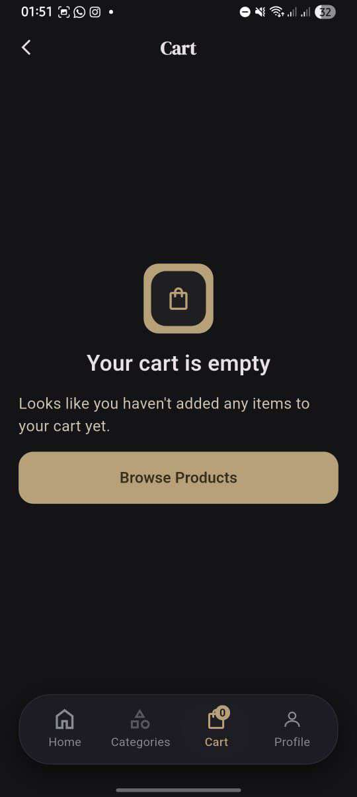
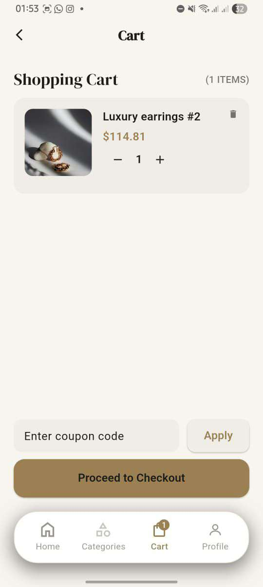
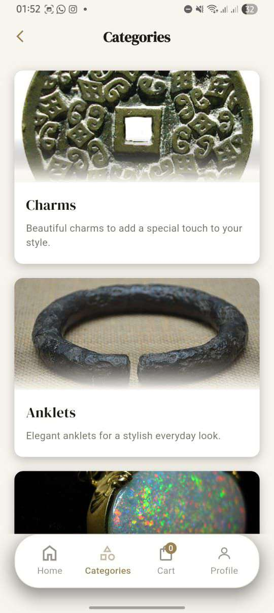
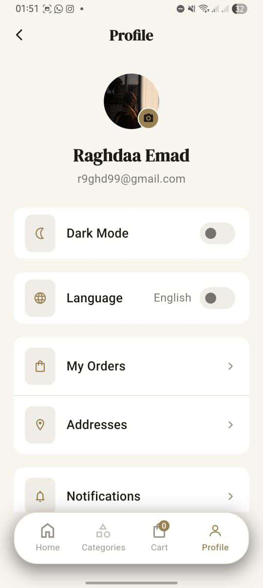
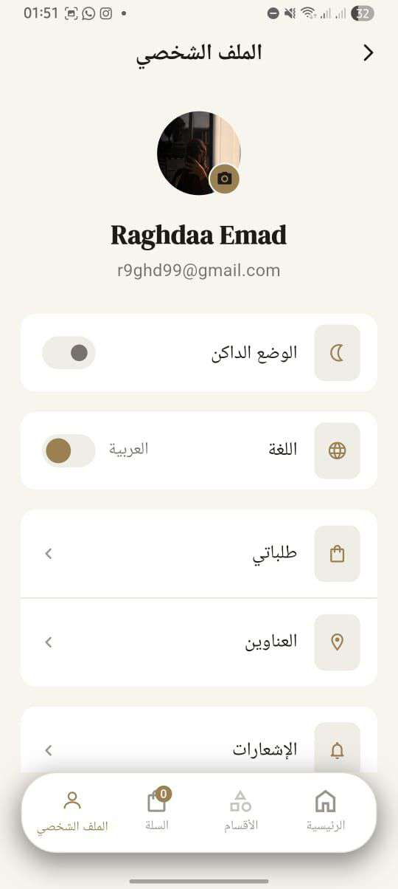
</div>

</details>

### Admin Dashboard

<div align="center">
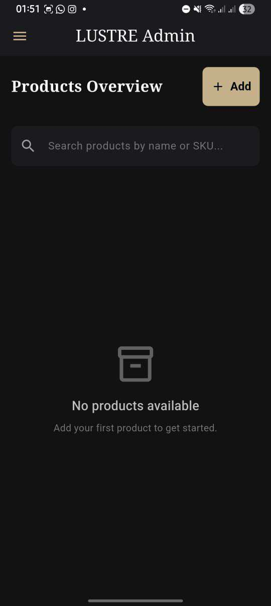
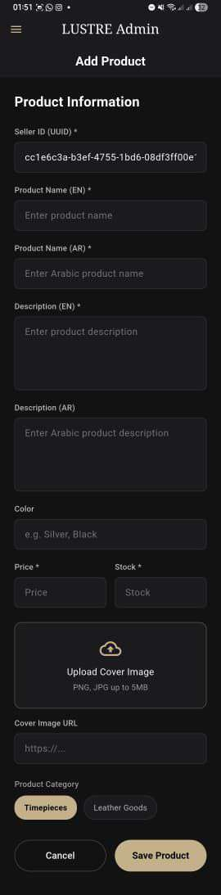
</div>

---

## Demo

> 🎥 **Demo video:** _add your YouTube / Google Drive link here_
> 📦 **Download APK:** _add a link to your release APK (GitHub → Releases)_

---

## Tech Stack

| Category | Technology |
| --- | --- |
| Framework | [Flutter](https://flutter.dev) (Dart) |
| State management | `flutter_bloc` / `bloc` (Cubit) |
| Networking | `dio`, `pretty_dio_logger` |
| Functional error handling | `dartz` (`Either`), `equatable` |
| Secure storage | `flutter_secure_storage` (auth tokens) |
| Authentication | Email + OTP, `google_sign_in` |
| Localization | `flutter_localizations`, `intl` (ARB files — EN / AR) |
| Responsive UI | `flutter_screenutil` |
| UI & assets | `google_fonts`, `flutter_svg`, `timeline_tile`, `pinput`, `pin_code_fields`, `fluttertoast` |
| Media & files | `image_picker`, `file_picker`, `path_provider` |

---

## Architecture

The app follows a **feature-first, layered architecture**. Each feature is split into a `data` layer (models, remote data sources, repositories) and a `presentation` layer (screens, widgets, cubits), with shared code in `core`.

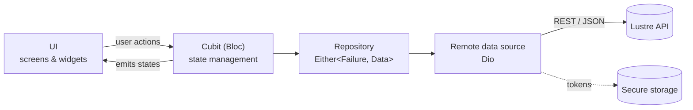

### User Journey

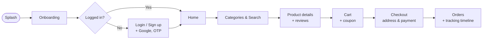

---

## Project Structure

```
lib/
├── core/
│   ├── cache/            # Secure storage helpers
│   ├── errors/           # Failure & error handling
│   ├── helper/           # Validators, strings
│   ├── language/         # Language cubit & content localization
│   ├── network/          # Dio factory & API constants
│   ├── routing/          # Route generator & route names
│   ├── shared_widgets/   # Reusable widgets (product card, nav bar, ...)
│   ├── theme/            # Light / dark themes & theme cubit
│   └── utils/            # Colors, styles, image paths
├── feature/
│   ├── onboarding/  splash/  auth/  home/  categories/  search/
│   ├── product_details/  cart/  order/  adresses/  profile/  admin/
│   └── main/             # Bottom-navigation shell
├── l10n/                 # app_en.arb, app_ar.arb
└── main.dart
```

---

## Design System

Lustre uses a warm **gold-on-charcoal** identity with a luxury serif for headings (**DM Serif Display**) and clean sans-serif body text — available in both dark and light themes.

| Token | Dark | Light |
| --- | --- | --- |
| Primary (gold) |  `#C9AE7C` |  `#9B8054` |
| Background |  `#131315` |  `#F8F5EF` |
| Surface / cards |  `#1C1C1F` |  `#FFFFFF` |
| Primary text |  `#F2F2F2` |  `#1E1B16` |
| Danger |  `#F08A8A` |  `#C94B4B` |

---

## Getting Started

### Prerequisites

- [Flutter SDK](https://docs.flutter.dev/get-started/install) (stable channel, Dart `>=3.13.1`)
- Android Studio or VS Code with the Flutter extension
- An Android emulator / iOS simulator or a physical device

### Installation

```bash
# 1. Clone the repository
git clone https://github.com/mohamedshabaan223/E_commerce_App.git
cd E_commerce_App

# 2. Install dependencies
flutter pub get

# 3. Generate localization files
flutter gen-l10n

# 4. Run the app
flutter run
```

### Build a release APK

```bash
flutter build apk --release
```

> **Google Sign-In:** to use it on your own build, register your app's package name and SHA-1 fingerprint in your Google Cloud / Firebase project.

---

## Backend API

The app consumes a REST API configured in [`lib/core/network/api_constatnt.dart`](lib/core/network/api_constatnt.dart):

```dart
static const String baseUrl = 'https://accessories-eshop.runasp.net/api/';
```

| Area | Endpoints (examples) |
| --- | --- |
| Auth | `auth/register`, `auth/verify-email`, `auth/login`, `auth/google/mobile`, `auth/refresh-token`, `auth/change-password`, `auth/logout` |
| Products | `products` |
| Cart | `cart`, `cart/items`, `cart/items/decrement`, `cart/apply-coupon` |
| Reviews | `reviews/{productId}` |

To point the app to your own server, change `baseUrl` in that file.

---

## Roadmap

- [x] Authentication (email OTP, Google Sign-In, password reset)
- [x] Product catalog, categories, search, and reviews
- [x] Cart with coupons, checkout, and order tracking
- [x] Dark / light themes and English / Arabic (RTL)
- [x] Admin product management
- [ ] Wishlist / favorites
- [ ] Online payment gateway integration
- [ ] Push notifications for order updates
- [ ] Role-based admin access from the backend
- [ ] Unit & widget test coverage

---

## Team

| # | Name | Role | GitHub |
| :-: | --- | --- | --- |
| 1 | **Raghdaa Emad Elsayed** | _Role_ | [@raghdaaaaa](https://github.com/raghdaaaaa) |
| 2 | **Mohamed Shabaan Abdelrazik** | _Role_ | [@mohamedshabaan223](https://github.com/mohamedshabaan223) |
| 3 | **Reham Mohamed Nofal** | _Role_ | [@reham-05](https://github.com/reham-05) |
| 4 | **Ahmed Mahmoud Hassan** | _Role_ | [@medo337](https://github.com/medo337) |
| 5 | **Sohailah Mohammed Eliwa** | _Role_ | [@sohailahazab257-droid](https://github.com/sohailahazab257-droid) |
| 6 | **Malak Mahmoud Elgizawy** | _Role_ | [@malakelgizawy11](https://github.com/malakelgizawy11) |
| 7 | **Alaa Diaa Mohamed** | _Role_ | [@haladiaa47-create](https://github.com/haladiaa47-create) |
| 8 | **Mervat Hamed Elshafie** | _Role_ | [@Nevo-code](https://github.com/Nevo-code) |

**Supervisor:** _Dr. Full Name_
**Faculty / University:** _Faculty of ..., University name_ — Graduation Project, _2026_

---

## Acknowledgements

- [Flutter](https://flutter.dev) and the open-source packages listed above
- Our supervisor and faculty for their guidance and support

---

## License

Distributed under the **MIT License**. See [`LICENSE`](LICENSE) for details.
